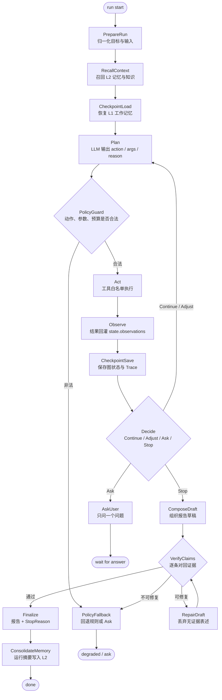
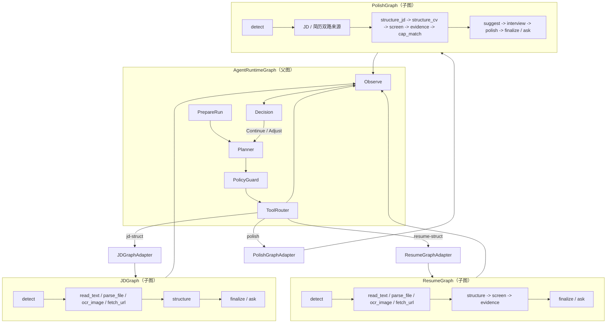
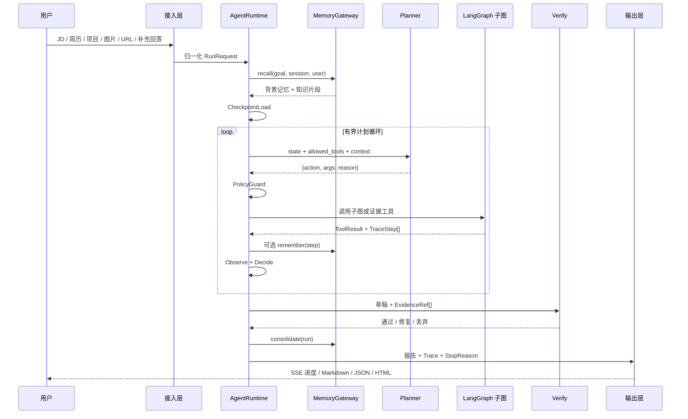
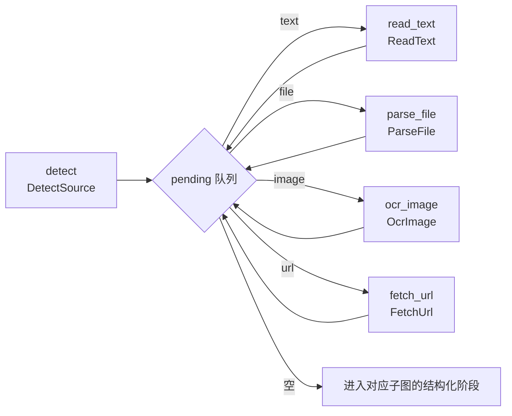
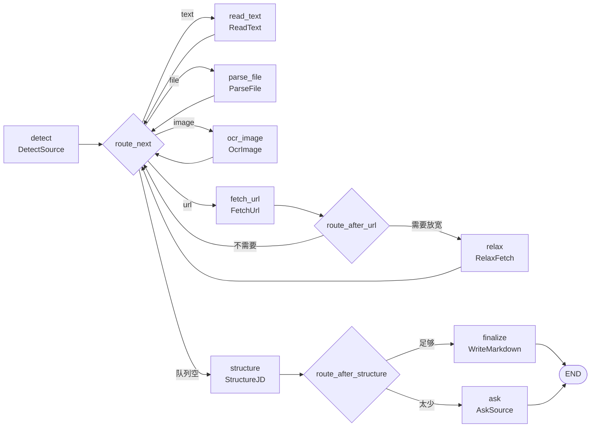
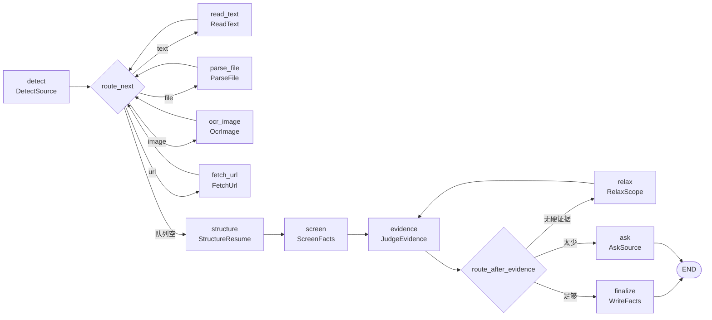
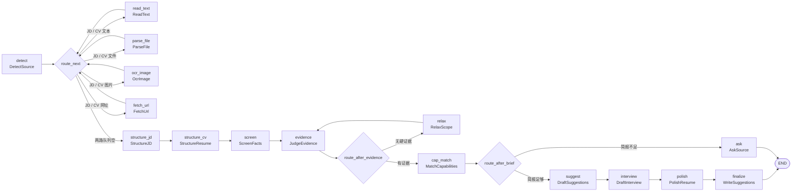
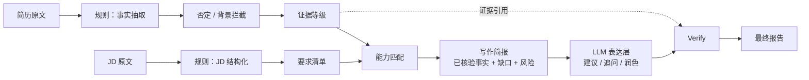
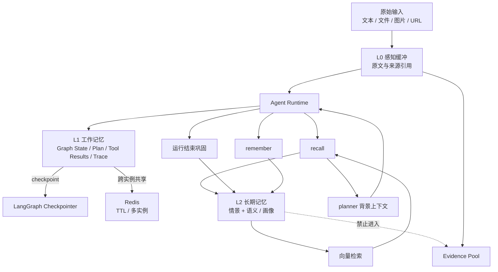
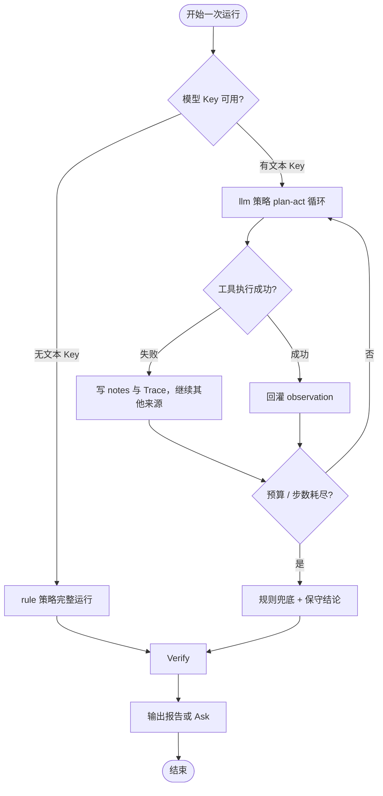

# AI 求职尽调 Agent v4 · 系统架构与 LangGraph 设计

> 当前版本：**v4**
>
> v4 的架构核心是一句话：**外层是有界的 plan → act → observe Agent Runtime，内层是可复用的 LangGraph 子图，规则负责事实与证据，LLM 负责规划与表达。**

---

## 1. 架构定位

v4 不是“把整条业务链交给一个 LLM 自由发挥”，也不是“把固定流程图换名字”。

它把系统拆成两种职责不同的运行时：

| 运行时 | 负责什么 | 不负责什么 |
|---|---|---|
| **Agent Runtime** | 读目标、读记忆、选择下一步、调用工具、观察结果、决定 Continue / Adjust / Ask / Stop | 不直接创造事实，不绕开证据规则 |
| **LangGraph 子图** | 在受控输入上完成可复现的取证、结构化、筛选、匹配与表达准备 | 不决定全局下一步，不改变证据等级 |
| **规则与证据层** | 来源解析、事实抽取、否定与背景拦截、证据分级、阈值、StopReason | 不做自由文本创作 |
| **LLM 层** | Planner 决策、JD / 简历表达、追问预演、润色、辅助校验 | 不把未核验内容写成事实 |

由此形成四层数据平面：

```mermaid
flowchart TB
    A["输入与接入层<br/>CLI / Vue3 Web / FastAPI / Python API"] --> B["Agent Runtime<br/>AgentPolicy + Planner + Observe + Decision + Verify"]
    B --> C["LangGraph 子图层<br/>JDGraph / ResumeGraph / PolishGraph"]
    B --> D["工具与证据层<br/>Tool Registry / Evidence Gate / Rule Services"]
    C --> D
    D --> E["记忆与知识层<br/>L0 / L1 / L2 + Knowledge Base"]
    E --> B
    D --> F["模型层<br/>DeepSeek / Qwen-VL / Embedding"]
    B --> G["输出层<br/>Trace / Markdown / JSON / HTML / SSE"]
    F --> B

    classDef runtime fill:#e8f1ff,stroke:#3366cc,color:#102a43
    classDef graph fill:#eef8ee,stroke:#3a8a3a,color:#173d17
    classDef data fill:#fff6e5,stroke:#b7791f,color:#4a2b00
    classDef output fill:#f4ecff,stroke:#7048b6,color:#2f1b55

    class B runtime
    class C graph
    class D,E data
    class F,G output
```

---

## 2. v4 分层架构

### 2.1 接入层

接入层只做输入归一化、运行参数、进度输出与结果落盘，不复制业务判定：

- **CLI**：单次判定、JD / Resume / Polish 子命令、批量岗位、简历排版；
- **Web 前端**：Vue3，五页分别是输入 / 进度 / 报告 / 简历润色 / 历史；
- **FastAPI 后端**：SSE 流式返回 Trace，md / json / html 三种报告格式；
- **Python API**：`run_agent(...)` 与三条子图入口。

所有入口最后都进入同一套 `AgentPolicy`、同一份工具注册表和同一份 Trace 契约。

### 2.2 Agent Runtime 层

Agent Runtime 是 v4 的外层执行器，用有界 LangGraph 表达：



运行时职责边界：

| 组件 | 职责 |
|---|---|
| `AgentPolicy` | 策略选择、工具白名单、步数上限、调用预算、证据阈值、Ask / Stop 规则 |
| `Planner` | 根据目标、上下文和工具表输出 `{action, args, reason}` |
| `PolicyGuard` | 校验 action 是否在白名单、args 是否符合 schema、是否超过预算 |
| `ToolRegistry` | 按 slug 发现工具，统一 `Tool` / `ToolResult` 契约 |
| `Observer` | 把工具输出、状态变更、证据变更写回 Graph State |
| `DecisionEngine` | 产生四值 Decision，并保留理由 |
| `Verify` | 把 LLM 文字逐条映射到规则证据，挡住无出处表述 |
| `MemoryGateway` | 召回、注入、写回、固化，严格与证据池隔离 |

### 2.3 LangGraph 子图层

v4 把三张已经稳定的图注册为可调用子图：

- `JDGraph`：全模态 JD 输入转统一 Markdown；
- `ResumeGraph`：全模态简历输入转事实条目与证据等级；
- `PolishGraph`：JD 要求与简历事实对照，产出写作简报、建议写法、追问预演和润色。

子图既是独立命令，也是 Runtime 工具白名单中的工具。调用边界统一为：

```text
AgentRuntime
  -> ToolAdapter("jd-struct")
  -> JDGraph / ResumeGraph / PolishGraph
  -> 返回 ToolResult + TraceStep[]
  -> Observer 回灌外层 state
```

子图状态与主运行状态隔离，避免子图内部细节污染全局状态；子图产出的 `TraceStep` 由适配器带前缀并入总 Trace。

父子图关系如下：



### 2.4 工具与证据层

工具分三类：

| 类型 | 例子 | 规则边界 |
|---|---|---|
| 输入获取工具 | `read_text` / `parse_file` / `ocr_image` / `fetch_url` | 图片与网址可能联网；失败只降级，不伪造内容 |
| 证据处理工具 | `jd-struct` / `resume-struct` / `resume-evidence` / `resume-negation` / `cap-match` | 输出事实、等级、出处；不产出结论 |
| 记忆工具 | `recall` / `remember` | 只提供背景与偏好，禁止进入 JD / 简历证据池 |

`EvidenceGate` 是统一闸门：

```text
候选结论
  -> 是否有 EvidenceRef
  -> EvidenceRef 是否指向 L0 原文
  -> 证据等级是否满足当前阈值
  -> 是否被否定 / 背景拦截
  -> 通过 / 降级 / Ask / 丢弃
```

### 2.5 记忆与知识层

v4 的 L0 / L1 / L2 语义固定如下：

| 层 | 名称 | 存什么 | 运行时作用 |
|---|---|---|---|
| **L0** | 感知与输入缓冲 | 原始文本、文件、图片、原始 HTML、上传件 | 可回放、可追溯，所有证据最终回到这里 |
| **L1** | 工作记忆 | 当前目标、计划、动作、工具结果、证据状态、Trace | LangGraph checkpointer 恢复；Redis 提供跨实例共享与 TTL |
| **L2** | 长期记忆 | 历次运行摘要、情景记忆、用户画像、偏好、已确认任务 | 向量检索后注入 planner 背景，不参与证据判定 |

知识与记忆分开管理：

| 系统 | 内容 |
|---|---|
| 记忆 | 这次和以前发生过什么：运行摘要、决策、偏好、任务 |
| 知识库 | 从资料里能检索到什么：方法论、词典、历史 JD、项目描述、报告 |

### 2.6 模型层

| 模型 | 用途 | 允许输出 | 禁止事项 |
|---|---|---|---|
| DeepSeek 文本模型 | Planner、建议写法、追问预演、润色、辅助校验 | `{action,args,reason}`、文字草稿、候选追问 | 不得直接写 EvidenceRef，不得改 Decision |
| Qwen-VL | 图片逐字转写 | Markdown 转录文本 | 不翻译、不总结、不补原文没有的内容 |
| Embedding 模型 | L2 与知识库向量检索 | 向量 | 不参与证据等级判定 |

没有文本 Key 时，`rule` 策略仍可完整运行；没有视觉 Key 时，图片输入降级为来源失败说明；没有 Embedding Key 时，检索退化为确定性的本地嵌入，不改变事实口径。

---

## 3. 外层 Agent Loop：Plan → Act → Observe → Decide

### 3.1 单步契约

Planner 每步只能返回一个 JSON 对象：

```json
{
  "action": "run_jd_graph",
  "args": {
    "text": "",
    "files": [],
    "images": [],
    "urls": []
  },
  "reason": "当前缺少可核验的 JD 要求，需要先把来源转成统一结构"
}
```

执行规则：

1. `action` 必须在 `AgentPolicy.allowed_tools` 中；
2. `args` 必须通过工具自己的 schema 校验；
3. 每一步必须带 `reason`；
4. 工具只能返回 `ToolResult`；
5. 结果必须由 Observer 回灌；
6. 预算耗尽、证据够了或缺少用户专属事实时，循环必须结束。

### 3.2 四值 Decision

| Decision | 条件 | 状态变化 | 下一步 |
|---|---|---|---|
| `Continue` | 当前目标已推进，按计划继续 | 追加 observation，更新证据或上下文 | 回到 Planner |
| `Adjust` | 严格口径召回不足 | 切换放宽口径、换来源或换工具 | 重新执行检索 |
| `Ask` | 缺少只有用户知道的事实 | 写 `question` 与 `question_reason` | 等用户回答 |
| `Stop` | 证据足够或无法继续取得新信息 | 写 `StopReason` 与最终产物 | Finalize |

### 3.3 Trace 契约

每一步都写入同一条四要素记录：

| 字段 | 含义 |
|---|---|
| `Action` | 做了什么，节点名 / 工具名 |
| `Observation` | 实际看到什么，带行号、文件、数量、失败原因 |
| `State Update` | 状态被改成了什么 |
| `Decision` | Continue / Adjust / Ask / Stop，以及为什么 |



### 3.4 Verify 节点

Verify 不负责“生成”，只负责“检查能不能写”：

| 检查项 | 判定 |
|---|---|
| 每个事实句是否有 EvidenceRef | 没有则丢弃 |
| EvidenceRef 是否指回 L0 | 不能指回则丢弃 |
| 是否把仅提及写成熟练 / 精通 | 降级表达 |
| 是否把否定写成肯定 | 直接丢弃 |
| 是否把记忆当 JD / 简历证据 | 直接丢弃 |
| 修复后是否仍有结论 | 没有则 Ask 或输出保守结论 |

---

## 4. LangGraph 子图设计

### 4.1 共享输入子图

JD、Resume、Polish 三张图的前半段共享同一种来源调度方式：



四种来源的口径：

| 来源 | 处理 | 是否联网 |
|---|---|---|
| 文本 | 直接读取、清洗 | 否 |
| 文件 | 文件解析工具，支持 md / txt / html / json / yaml 等 | 否 |
| 图片 | Qwen-VL 逐字转写，数字与指标提示人工复核 | 是 |
| 网址 | 一次 HTTP 抓取 + HTML 转 Markdown，缓存原始页面 | 是 |

来源失败只降级，不中断整张图；失败原因进入 `state.notes`，最后写进 `StopReason`。

### 4.2 JDGraph

节点数：**9**



关键规则：

- 少于 `MIN_JD_BULLETS = 3` 条要点时进入 Ask；
- 网址严格口径少于 `MIN_URL_LINES = 5` 行时先 Adjust；
- Adjust 复用已经抓到的 HTML，不重复发请求；
- `state.pages` 保留网址原始内容，支持回放。

子图输出：

- `state.structured`：岗位、职责、要求、加分项、能力命中；
- `state.markdown`：统一模板 JD；
- `state.trace`：每一步四要素；
- `state.question` / `state.stop_reason`：Ask 或 Stop 的出口说明。

### 4.3 ResumeGraph

节点数：**11**



判定顺序固定为：

```text
structure -> screen -> evidence
```

也就是：

1. 先拆章节和事实；
2. 先挡“写了但没做过”和“只是背景”；
3. 再判“有结果 / 有动作 / 仅提及”。

关键规则：

- `MIN_FACTS = 3`：可当证据的事实少于 3 条时 Ask；
- `MIN_SOLID_FACTS = 1`：严格口径一条硬证据都没有时 Adjust 一次；
- 放宽只放宽证据强弱，否定与背景永远不放；
- 每条事实保留 `文件::L行号` 或来源引用。

### 4.4 PolishGraph

节点数：**16**



模型调用纪律：

| 项目 | 口径 |
|---|---|
| 调用账本 | 复用 `CallBudget` |
| 默认总上限 | 10 次 |
| 单次超时 | 30 秒 |
| 失败重试 | 1 次 |
| 失败影响 | 单块降级，规则简报照常输出 |
| 模型输入 | 只读规则生成的写作简报，不读完整 JD / 简历 |
| 模型输出 | 建议写法 / 追问预演 / 润色，均带 `source` 标记 |

PolishGraph 的“先规则、后模型”边界：



---

## 5. 记忆系统：L0 / L1 / L2

### 5.1 数据流



### 5.2 L0 感知与输入缓冲

L0 是不可变的原始材料层：

- JD 原始文本 / HTML / 图片；
- 简历原始文本 / 文件 / 图片；
- 项目描述；
- 用户 `--answer` 补充；
- Web 上传件；
- 抓取到的原始 HTML。

每条 L0 记录至少包含：

```text
l0_id
source_type
source_ref
media_type
content_hash
raw_uri 或 raw_blob
created_at
```

L0 的使命是回放与追溯，不是“可改写的上下文”。任何证据引用最终都应指回 L0。

### 5.3 L1 工作记忆

L1 就是当前运行的 Graph State：

- 目标与运行参数；
- 当前计划；
- 下一步 `action / args / reason`；
- 每一步 `ToolResult`；
- 当前证据池与能力匹配；
- 完整 Trace；
- Ask / Stop 状态。

持久化方式：

| 模式 | 用途 |
|---|---|
| LangGraph Checkpointer | 恢复运行状态，支持断点与重放 |
| SqliteSaver | 本地开发与单机默认底座 |
| Redis | 多实例共享、TTL、会话级工作记忆 |

### 5.4 L2 长期记忆

L2 存两类内容：

| 类型 | 内容 | 例子 |
|---|---|---|
| 情景记忆 | 历次运行摘要 | “某项目对某 JD 的结论、覆盖率、缺口” |
| 语义 / 画像 | 跨会话稳定事实与偏好 | “用户偏后端”“不希望夸大项目职责” |

写回与固化：

```text
运行结束
  -> 生成 RunSummary
  -> 抽取可长期复用的事实 / 偏好 / 任务
  -> 生成稳定 memory_id
  -> 按 fingerprint 去重
  -> 写入 L2
  -> 进入向量索引
```

去重原则：

- L1 固化到 L2 时保留来源 `memory_id` 与 lineage；
- 使用 `content_hash + user_id + kind` 作为幂等键；
- 同一内容再次固化时不新增重复条目，只更新引用或时间戳；
- Redis / 向量索引与 JSONL / Mongo 存储使用同一幂等键。

### 5.5 记忆工具

| 工具 | 输入 | 输出 | 边界 |
|---|---|---|---|
| `recall` | query、session、user、limit、类型过滤 | 相关记忆与出处 | 只进 planner 上下文 |
| `remember` | 内容、kind、importance、metadata | 写入 L1，必要时固化 L2 | 不进入证据池 |

硬约束：

```text
memory_context 与 evidence_pool 是两套对象
memory_context 可以被 Planner 读取
memory_context 不能被 Verify 当作 EvidenceRef
```

---

## 6. Tool Registry 与 AgentPolicy

### 6.1 工具注册表

所有工具统一继承 `Tool`，统一返回 `ToolResult`：

```text
Tool
  slug
  title
  summary
  usage
  run(args) -> ToolResult

ToolResult
  ok
  markdown
  data
  summary[]
  notes[]
  written[]
  trace[]
```

v4 白名单中的工具：

| slug | 作用 | 是否产生证据 | 可被 Planner 调用 |
|---|---|---|---|
| `read_text` | 读取文本来源 | 是 | 是 |
| `parse_file` | 解析文件来源 | 是 | 是 |
| `ocr_image` | Qwen-VL 逐字转写 | 是 | 是 |
| `fetch_url` | 抓取网址与转 Markdown | 是 | 是 |
| `jd-file` | JD 文件解析 | 是 | 是 |
| `jd-struct` | JD 结构化 | 是 | 是 |
| `resume-struct` | 简历结构化 | 是 | 是 |
| `resume-negation` | 否定 / 背景拦截 | 调整证据资格 | 是 |
| `resume-evidence` | 证据等级判定 | 是 | 是 |
| `cap-match` | 能力词典匹配 | 是 | 是 |
| `resume` | 简历排版 | 否 | 可选 |
| `recall` | 召回 L2 | 否 | 是 |
| `remember` | 写入记忆 | 否 | 是 |

### 6.2 AgentPolicy

`AgentPolicy` 是运行时宪法，控制：

| 配置 | 说明 |
|---|---|
| `strategy` | `rule` 或 `llm` |
| `allowed_tools` | 当前可调用工具白名单 |
| `max_steps` | 有界循环步数上限 |
| `max_rounds` | Ask 轮次上限 |
| `call_budget` | 文本 / 视觉 / Embedding 调用预算 |
| `evidence_thresholds` | 覆盖、事实数、硬证据门槛 |
| `relax_policy` | 什么情况下允许 Adjust |
| `ask_policy` | 什么情况下必须把问题交回用户 |
| `stop_policy` | 什么情况下可以 Stop |
| `verify_policy` | 哪些输出必须逐条校验 |
| `memory_policy` | 召回范围、注入方式、写回与固化条件 |

两种策略共享同一套工具、Trace 与判定阈值：

| 策略 | 行为 |
|---|---|
| `rule` | 规则路由，离线、可复现、测试稳定 |
| `llm` | Planner 驱动 plan → act → observe，加 Verify |

---

## 7. 关键不变量

v4 的架构约束可以压缩成以下不变量：

1. **证据只来自 L0**：任何判定都不能引用 LLM 自述或记忆摘要作为事实。
2. **LLM 不写事实**：LLM 只能选择动作和组织语言，不能直接写入证据等级。
3. **工具不越界**：不在白名单中的 action 一律拒绝。
4. **每步必有 reason**：没有理由的动作不是可审计动作。
5. **每步必有 Trace**：Action / Observation / State Update / Decision 四要素缺一不可。
6. **Ask 只问一个**：缺的是只有用户知道的事实，一次只问一个最关键的问题。
7. **Adjust 不放宽伪装**：否定与背景永远不放宽。
8. **Stop 必须写 StopReason**：停止不是没有下一步，而是证据已经够或再查不会产生新信息。
9. **记忆不参与判定**：记忆只提供背景与偏好，不进入 JD / 简历证据池。
10. **Verify 是最后一道闸**：组织好的文字必须逐条对回证据，对不上就不进报告。

---

## 8. 失败与降级路径



降级原则：

- 来源失败不等于运行失败；
- 模型失败不等于报告失败；
- 视觉失败只影响图片来源；
- 记忆不可用不影响判定；
- 知识检索不可用不影响判定；
- 不完整材料只允许形成保守结论或 Ask，不允许编造。

---

## 9. 目录与模块映射

```text
AI_Job_Research_Agent/
├── main.py                         # CLI 入口
├── streamlit_app.py                # Streamlit 可选入口
├── api/main.py                     # FastAPI 入口
├── ARCHITECTURE.md                 # 本文档
├── README.md                       # 产品说明
├── frontend/                       # Vue3 前端
├── jd_agent/
│   ├── agents/
│   │   ├── agent.py                # 主流程与外层运行入口
│   │   ├── jd_graph.py             # JDGraph
│   │   ├── resume_graph.py         # ResumeGraph
│   │   ├── polish_graph.py         # PolishGraph
│   │   ├── generate.py             # LLM 调用账本与装饰层
│   │   └── graph_view.py           # Mermaid / PNG 图渲染
│   ├── tools/                      # Tool Registry 与工具实现
│   ├── memory/                     # L0 / L1 / L2 记忆
│   ├── knowledge/                  # 知识库与向量检索
│   ├── services/                   # 来源识别、抓取、视觉转写
│   ├── domain/                     # 规则、词典、事实、证据
│   ├── core/                       # Schema、Settings、LLM Client
│   └── api/                        # FastAPI router / service / store
├── knowledge/                      # L1 静态知识
├── data/                           # 记忆、索引、上传临时文件
├── input/                          # JD / 项目 / 简历
├── output/                         # 报告与 Trace
└── tests/                          # 离线测试集
```

---

## 10. 图渲染与 Trace 对照

每张 LangGraph 图都通过 `compiled_graph()` 编译，`graph_view.show_graph(...)` 支持：

```python
from jd_agent.agents.graph_view import show_graph
from jd_agent.agents.jd_graph import compiled_graph

show_graph(compiled_graph(), method="mermaid")
```

Mermaid 输出可作为文档图，Trace 输出可与图节点逐条对照：

| 图对象 | 入口 | Trace Action 前缀 |
|---|---|---|
| JDGraph | `run_jd_agent()` | `DetectSource` / `ReadText` / `StructureJD` / `WriteMarkdown` |
| ResumeGraph | `run_resume_agent()` | `StructureResume` / `ScreenFacts` / `JudgeEvidence` / `WriteFacts` |
| PolishGraph | `run_polish_agent()` | `MatchCapabilities` / `DraftSuggestions` / `DraftInterview` / `PolishResume` |

---

## 11. v4 架构总结

```text
用户与多模态输入
  -> L0 原始输入可回放
  -> Agent Runtime 读目标、召回记忆、规划动作
  -> Tool Registry 只执行白名单工具
  -> LangGraph 子图完成 JD / Resume / Polish 的受控工作流
  -> 规则生成 EvidenceRef 与证据等级
  -> LLM 只负责规划和表达
  -> Verify 把每句话对回证据
  -> L1 checkpointer / Redis 保住工作记忆
  -> L2 向量检索沉淀情景、画像与偏好
  -> 输出可审计 Trace、报告与简历建议
```

这就是 v4 的边界：**Agent 可以自主选择下一步，但不能自主创造事实；LangGraph 子图可以并行扩展能力，但不能绕开证据规则；记忆可以让系统更懂用户，但不能污染 JD / 简历判定。**
